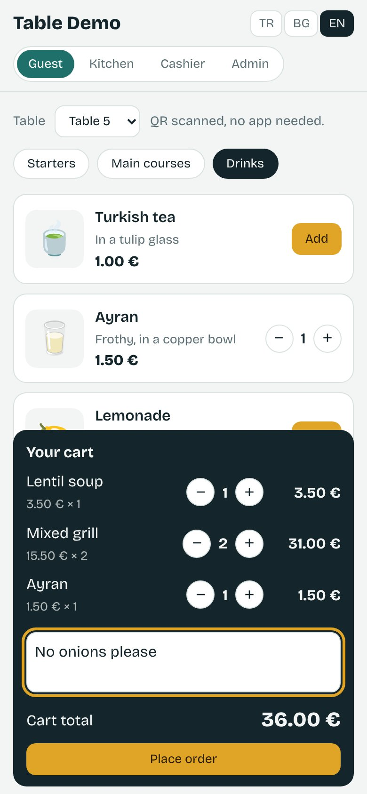
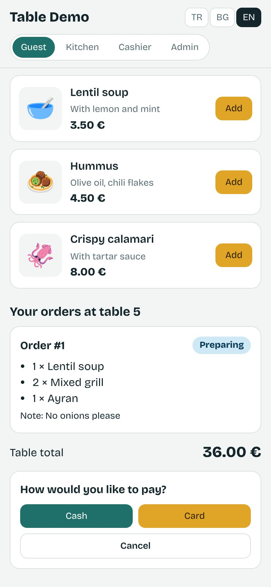
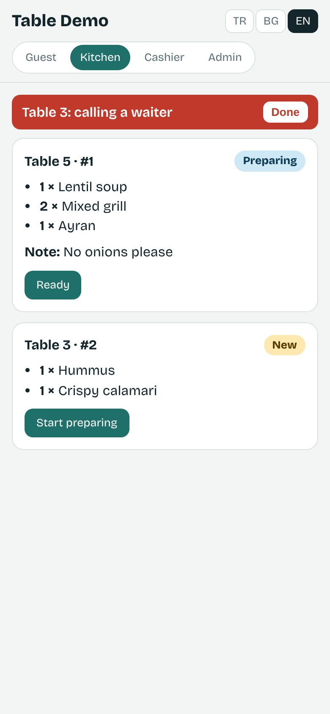
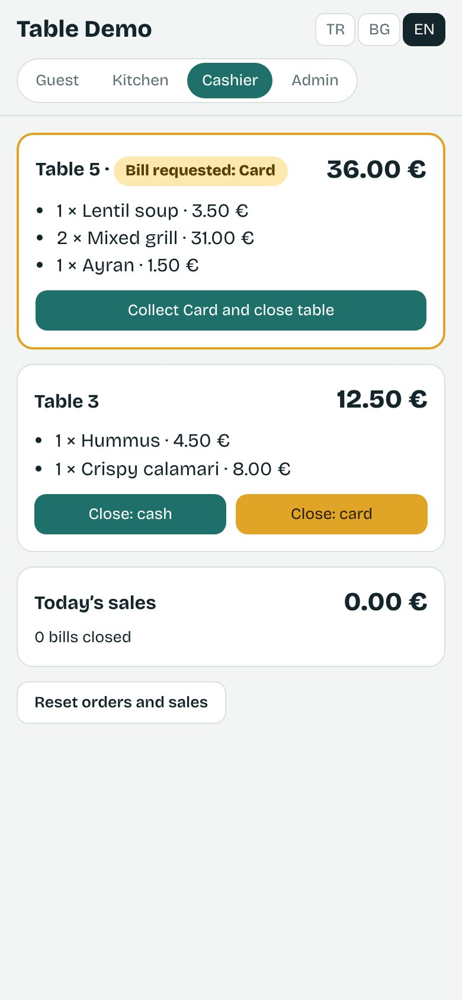
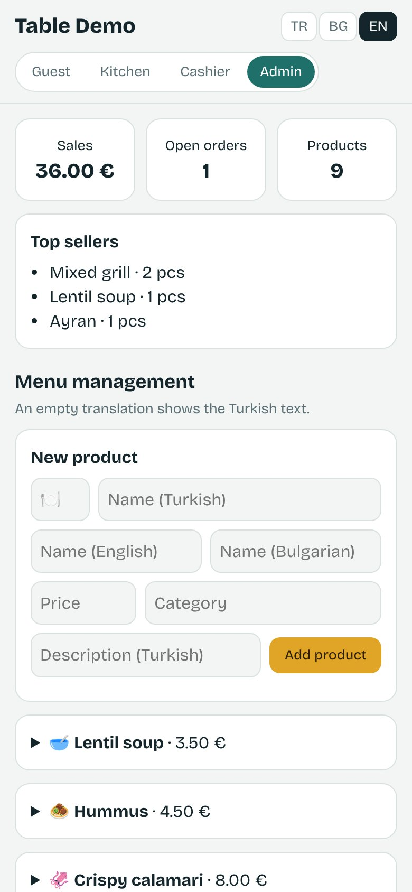

# QR Table Ordering – Restaurant Demo

> **Work-in-progress demo.** A prototype I built to pitch to restaurants in Bulgaria. It has not been used in a real restaurant yet.

Guests scan the QR code on their table and order from their phone, with no app to install. The order goes straight to the kitchen, the guest sees its status live, and when they ask for the bill it goes **only to the cashier**, together with the payment method they picked (cash or card).

**Live demo:** https://muhammed200535-source.github.io/qr-table-ordering/

> **Try it:** open the demo in **two browser tabs**. Put one on **Guest** and the other on **Kitchen**, then place an order. It appears in the kitchen tab instantly, with a sound.

<p>
  
  
  
  
  
</p>

## How it works

```
Guest scans QR ─► picks dishes ─► Place order ─► Kitchen: New → Preparing → Ready → Served
      │                                              (guest sees each status change)
      ├─► Call waiter ─────────► alert on the staff screen
      └─► Ask for the bill ─► chooses Cash / Card ─► Cashier only ─► close table ─► sales report
```

## Screens

| Screen | What it does |
|---|---|
| **Guest** | Menu by category, cart with quantities and an order note, live order status, call waiter, ask for the bill (cash or card). |
| **Kitchen** | Incoming orders with notes, one button to move each order to the next status, waiter-call alerts, sound on new orders. |
| **Cashier** | Open tables with totals, bill requests shown first with the chosen payment method, close a table and record the sale. |
| **Admin** | Today's sales, open orders, top sellers, and menu management: add or edit dishes, prices, categories, mark items as sold out. |

All screens work in **Turkish, Bulgarian and English**, and support light and dark mode.

## Two versions

### 1. Demo (`index.html`)
A single HTML file that runs without a server. Data is kept in the browser (`localStorage`), and tabs stay in sync through the `storage` event. This is the version in the live demo, so it always works.

### 2. Production version (`production/`)
Built on **Supabase** (PostgreSQL + Realtime + Auth), so it works across many devices at once: guests' phones, a tablet in the kitchen, the cashier's computer.

- **5 pages:** guest (`index.html`), owner/admin + QR code page (`staff.html`), kitchen, waiter (`service.html`), cashier.
- **Staff log in** with email and password. Each account has a role: `owner`, `kitchen`, `service` or `cashier`.
- **Row Level Security:** every role can only read and change what it needs. For example, only the cashier can see payments.
- **Secure table links:** each table's QR code contains a secret token (`?masa=5&k=TOKEN`), so a guest can only see and order for their own table.
- **Realtime:** new orders and status changes appear on every screen without refreshing.

To set it up: create a Supabase project, run the SQL files in `production/sql/` in this order: `setup.sql`, `security.sql`, `security_roles.sql`. Then put your project URL and publishable key at the top of each page in `production/site/`.

The Supabase project used during development is paused (free plan), so the production pages are not live.

## Tech

- HTML, CSS and vanilla JavaScript (no framework, no build step)
- Supabase: PostgreSQL, Realtime, Auth, Row Level Security
- Hosted as static files (GitHub Pages / Cloudflare)

## Credits

Idea, product decisions and design by **Muhammed Selim**, inspired by existing QR ordering products. The code was written with AI assistance (Claude).
